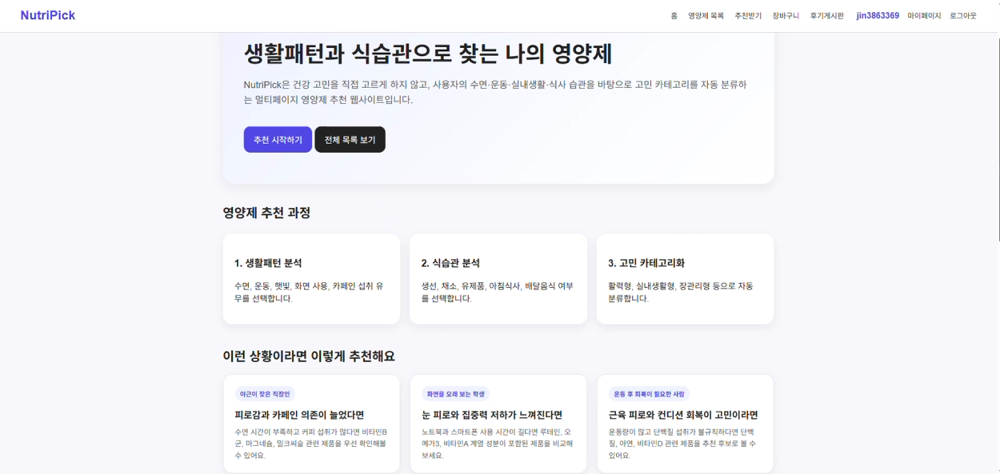
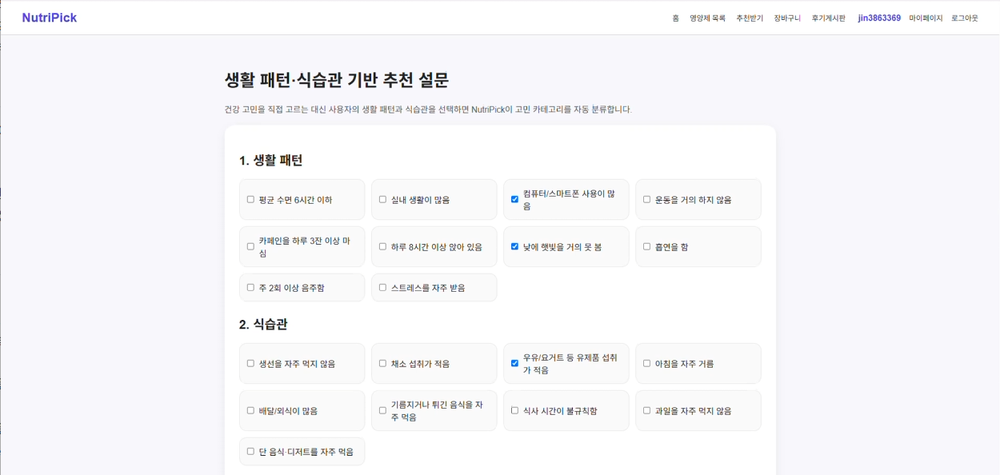
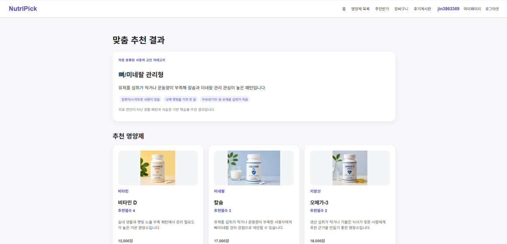
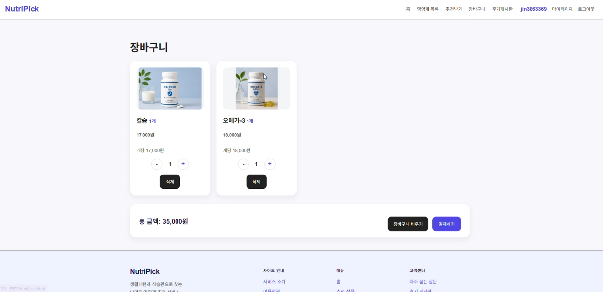
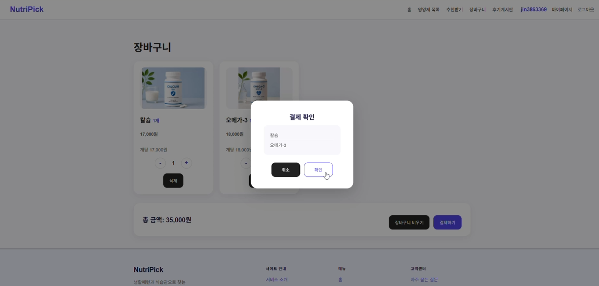
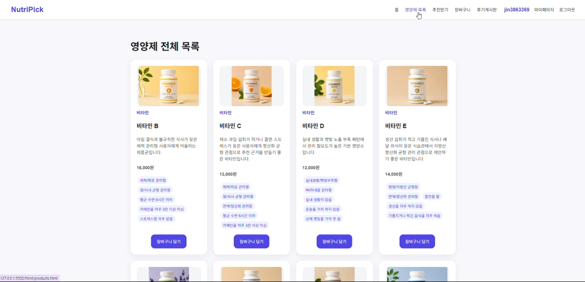

# NutriPick 영양제 추천 웹 멀티 페이지 프로젝트 
생활패턴·식습관 선택값을 분석해 영양제를 추천하는 JavaScript 기반 웹서비스
## 결과 화면 
| 메인페이지 | 설문페이지 |
| --- | --- | 
|  |  | 
| 맞춤추천결과 | 장바구니 | 
| --- | --- | 
|  |  | 
| 후기작성 | 영양제 전체목록 | 
| --- | --- | 
|  |  | 

## 1. 주요 요소
- 서비스명: NutriPick
- 주제: 생활패턴·식습관 기반 영양제 추천 멀티페이지 웹사이트
- 추천 방식: 건강고민을 직접 선택하지 않고, 사용자의 생활패턴과 식습관 선택값을 기반으로 고민 카테고리를 자동 분류
- 추천 기준: 1순위 생활패턴, 2순위 식습관
- 데이터 구조: JavaScript의 JSON 객체배열 형태로 영양제 데이터 관리
- 저장 방식: localStorage로 추천 선택값, 장바구니, 후기 데이터 저장

## 2. 타겟층
- 영양제를 처음 구매하려는 20~30대
- 피로, 실내생활, 불규칙 식사 등은 느끼지만 정확히 어떤 영양제가 필요한지 모르는 사용자
- 복잡한 의료 정보보다 간단한 생활 습관 기반 추천을 원하는 사용자
- 건강관리 입문자, 직장인, 학생, 장시간 컴퓨터 사용자가 주요 대상

## 3. 주요 핵심 기능
- 생활패턴 체크: 수면 부족, 실내생활, 화면 사용, 운동 부족, 카페인, 앉아있는 시간
- 식습관 체크: 생선 부족, 채소 부족, 유제품 부족, 아침 결식, 배달음식, 불규칙 식사
- 고민 카테고리 자동 분류: 활력/피로 관리형, 실내생활/햇빛부족형, 디지털 눈관리형, 장/식사균형 관리형, 뼈/미네랄 관리형, 혈행/지방산 균형형
- 추천 점수 계산: 선택값과 제품의 lifestyle, diet, matchCategories 일치 개수를 합산
- 추천 결과 정렬: 추천 점수가 높은 영양제 우선 출력
- 영양제 목록 페이지: 전체 상품 카드 출력
- 장바구니 기능: localStorage 기반 상품 담기/비우기
- 후기 게시판: localStorage 기반 후기 등록/목록 출력
- 서비스 소개 페이지: 기획 의도, 추천 기준, 기술 스택, 확장 방향 설명

## 4. 아키텍처 설계
```text
사용자
  ↓
index.html                 : 서비스 진입/소개
  ↓
survey.html                : 생활패턴·식습관 선택
  ↓ localStorage 저장
recommend.html             : 고민 카테고리 분류 + 추천 결과 출력
  ↓
products.html              : 전체 영양제 목록 확인
cart.html                  : 장바구니 확인
board.html                 : 후기 작성/조회
about.html                 : 서비스 소개

공통 데이터/로직
- data.js                  : 추천 카테고리, 설문 옵션, 영양제 데이터
- common.js                : 가격 포맷, 장바구니, 상품 카드 생성
- style.css                : 전체 디자인
```

## 5. 레이아웃 설계
### 홈 페이지
- 상단: 로고 + 메뉴 네비게이션
- 메인: 서비스 핵심 문구, 추천 시작 버튼, 전체 목록 버튼
- 하단: 생활패턴 분석 / 식습관 분석 / 고민 카테고리화 3개 카드

### 추천 폼 페이지
- 제목: 생활패턴·식습관 기반 추천 폼
- 생활패턴 체크박스 영역
- 식습관 체크박스 영역
- 추천 결과 보기 버튼

### 추천 결과 페이지
- 자동 분류된 사용자 고민 카테고리 박스
- 사용자가 선택한 생활패턴·식습관 태그
- 추천 영양제 카드 목록
- 카드 구성: 이미지, 카테고리, 제품명, 추천점수, 설명, 가격, 태그, 장바구니 버튼

### 전체 목록 페이지
- 모든 영양제 상품을 카드 그리드로 출력

### 장바구니 페이지
- 담은 상품 카드 목록
- 총 금액
- 장바구니 비우기 버튼

### 후기 게시판 페이지
- 닉네임, 영양제 이름, 후기 내용, 별점 입력
- 후기 목록 카드 출력

## 6. 확장 방향
- AI API 연동: 생활습관을 자연어·음성으로 입력하면 - 자동 분석 후 추천
- OCR 기능: 복용 중인 영양제 사진을 인식해 중복 추천 - 방지
- 예산/복용 성향 반영: 가격대, 복용 횟수, 제형(알약·젤리 등) 선택
- 상품 상세 페이지 제공
- FastAPI 및 DB 연동
- 추천 결과 저장 및 조회 기능 제공
